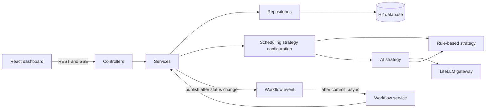

# SlotMind Code Documentation

This document is a map of the current implementation: where the main responsibilities live, how a rescheduling request moves through the code, and which files to change for common work. For installation, environment setup, and the complete API list, see [README.md](README.md). For architectural tradeoffs, see [ADR.md](ADR.md).

## Repository map

| Location | Responsibility |
|---|---|
| `backend/src/main/java/com/slotmind/SlotMindApplication.java` | Spring Boot entry point; enables asynchronous method execution. |
| `backend/src/main/java/com/slotmind/config/` | Strategy selection, async executor, CORS, and demo seed data. |
| `backend/src/main/java/com/slotmind/controller/` | HTTP routes, request validation, status parsing, and response mapping. |
| `backend/src/main/java/com/slotmind/dto/` | API request and response records. |
| `backend/src/main/java/com/slotmind/entity/` | JPA entities and their persisted state. |
| `backend/src/main/java/com/slotmind/enums/` | Provider, slot, appointment, suggestion, and trigger states. |
| `backend/src/main/java/com/slotmind/event/` | Event payload passed from status changes to recovery processing. |
| `backend/src/main/java/com/slotmind/exception/` | API exception types and HTTP error mapping. |
| `backend/src/main/java/com/slotmind/repository/` | Spring Data queries and database locking queries. |
| `backend/src/main/java/com/slotmind/service/` | Booking, status changes, mapping, workflow orchestration, and acceptance transactions. |
| `backend/src/main/java/com/slotmind/strategy/` | Shared scheduling contract, rule-based policy, AI policy, and LLM gateway. |
| `frontend/src/main.jsx` | Dashboard state, API calls, polling, SSE handling, and browser-local waitlist state. |
| `frontend/src/components/` | Booking, provider status, recommendation cards, and shared empty states. |
| `frontend/src/lib/` | API request and date/label formatting helpers. |
| `frontend/src/styles.css` | Dashboard layout, visual states, and responsive styles. |

## Architecture at a glance



## Backend responsibilities

### HTTP and API mapping

- `ProviderController`, `SlotController`, `AppointmentController`, and `SuggestionController` define the REST API under `/api`.
- Controllers validate request records and translate string status/action values into enums. They use `MappingService` to return DTOs rather than exposing JPA entities.
- `ApiExceptionHandler` converts domain errors into HTTP error responses.
- The API route list and example payloads are in [README.md](README.md#api).

### Domain and persistence

- `Provider` owns a specialty and a `ProviderStatus`.
- `Slot` belongs to a provider and stores its start time, duration, and `SlotStatus`.
- `Appointment` points to its patient, type, provider, slot, and lifecycle status.
- `RescheduleSuggestion` points to an appointment and proposed slot. It stores the original provider/time, confidence, patient-facing reasoning, source, trigger, and review status.
- `Appointment` and `Slot` carry JPA `@Version` fields. Critical repository methods use pessimistic write locks; see `AppointmentRepository.lockById`, `SlotRepository.lockById`, and `SuggestionRepository.lockById`.
- `SeedData` inserts demo providers, slots, and appointments only when the provider table is empty. Demo slot times are aligned to whole minutes. The configured H2 database is in-memory and is reset when the backend process restarts.

The lifecycle values are defined in `backend/src/main/java/com/slotmind/enums/`:

| Type | Values | Use |
|---|---|---|
| `ProviderStatus` | `AVAILABLE`, `BUSY`, `OFFLINE` | `OFFLINE` providers are excluded from destination recommendations. |
| `SlotStatus` | `OPEN`, `BOOKED`, `CANCELLED` | Only future `OPEN` slots can be booked or recommended. Cancellation is terminal through the status API. |
| `AppointmentStatus` | `CONFIRMED`, `RESCHEDULE_PENDING`, `RESCHEDULED`, `COMPLETED` | Pending is used when the booking needs review or recovery. Rescheduled and completed appointments are finalized. |
| `SuggestionStatus` | `PENDING`, `ACCEPTED`, `REJECTED` | Only a pending suggestion can be decided. |
| `TriggerReason` | `INITIAL`, `PROVIDER_OFFLINE`, `SLOT_CANCELLED` | Distinguishes manual requests from automatic recovery causes. |

### Services

- `AppointmentService` validates and books a new appointment in a transaction. It checks that the slot is open and in the future, belongs to the selected provider, and that the provider is not offline.
- `ProviderService` and `SlotService` lock and update statuses. A transition to `OFFLINE` or `CANCELLED` publishes a `WorkflowEvent` after a real state change.
- `WorkflowService` receives committed events asynchronously. Provider-offline events find confirmed appointments for that provider; slot-cancelled events find the confirmed appointment on that slot. It isolates per-appointment failures so one failure does not stop processing the rest of a provider's appointments.
- `SchedulingService` creates pending recommendations and handles accept/reject decisions. It builds eligible candidates, calls the configured strategy, rechecks proposed slots under lock, and saves a suggestion. Acceptance locks and reloads the appointment, suggestion, destination slot, and relevant provider; then it updates the appointment and slots in one transaction and rejects sibling pending suggestions.
- `MappingService` converts entities into API DTOs.

## Scheduling flow

### Automatic recovery

1. A status route calls `ProviderService.status` or `SlotService.status`.
2. The service saves the state change and publishes a `WorkflowEvent` inside the transaction.
3. `WorkflowService.onWorkflowEvent` handles the event after commit through `@TransactionalEventListener`; `@Async("workflowExecutor")` keeps the recovery work off the HTTP request thread.
4. The workflow finds affected confirmed appointments and calls `SchedulingService.processAutomatic` for each.
5. `SchedulingService.generate` locks the appointment, skips finalized appointments and duplicate pending suggestions for the same trigger, then finds future open slots. It excludes offline providers and destinations already reserved by pending suggestions. For a provider-offline trigger, it also excludes the offline provider.
6. The selected slot is refreshed and rechecked under a write lock before the pending suggestion is stored. The appointment moves to `RESCHEDULE_PENDING` when it was still confirmed.

The events are in-process and are not persisted to a durable queue. A process crash can therefore lose an in-flight workflow event.

`processAutomatic` marks a confirmed appointment `RESCHEDULE_PENDING` before candidate selection. If no eligible slot exists, no suggestion is stored; the appointment remains pending so the frontend can show the unresolved recovery item.

```mermaid
sequenceDiagram
    actor Staff
    participant API as Provider or slot controller
    participant Status as ProviderService or SlotService
    participant DB as Database
    participant Spring as Spring event listener
    participant Workflow as WorkflowService
    participant Scheduling as SchedulingService
    participant Strategy as Selected scheduling strategy

    Staff->>API: PATCH status to OFFLINE or CANCELLED
    API->>Status: Update status
    Status->>DB: Save status
    Status->>Spring: Publish WorkflowEvent in the transaction
    Status->>DB: Commit status transaction
    par Complete status request
        Status-->>API: Return status response
    and Start recovery asynchronously after commit
        Spring-->>Workflow: Dispatch event listener
        Workflow->>DB: Find affected confirmed appointment(s)
        loop Each affected appointment
            Workflow->>Scheduling: processAutomatic(id, trigger)
            Scheduling->>DB: Lock appointment and load eligible future slots
            Scheduling->>Strategy: Recommend from candidates
            Strategy-->>Scheduling: Ordered recommendations
            Scheduling->>DB: Lock and recheck selected slot; save pending suggestion
        end
    end
```

The status request returns before the recovery loop finishes. The loop creates suggestions for staff review; it does not book a replacement automatically.

### Recommendation strategies

`SchedulingStrategy` is the contract used by both manual and automatic callers. `SchedulingStrategyConfiguration` selects the primary implementation from `slotmind.scheduling.strategy`:

- `rule-based` is the default. `RuleBasedSchedulingStrategy` ranks the nearest future open slot from the same provider first (except when that provider is offline), then matching specialty, then other available slots.
- `ai` selects `AISchedulingStrategy`. It calls `LiteLLMGateway`, validates the returned slot against the real candidate list and current availability, checks any supplied alternate-provider ID, confidence, and reasoning, and rejects a choice that skips an available same-provider or matching-specialty slot. It then keeps deterministic alternatives available if the first choice becomes unavailable.
- AI responses with zero confidence or unverified clock/timezone claims in their explanation are rejected and use the deterministic fallback. The model prompt also asks for concise explanations without times because the UI displays the verified local appointment time separately.
- Recommendations can use another specialty when no preferred match is available. The UI identifies that change and asks staff to confirm the alternative is appropriate before acceptance.
- Missing credentials, gateway errors, malformed output, or invalid recommendations fall back to `RuleBasedSchedulingStrategy`.

AI mode is optional. A successful AI recommendation is still only a suggestion; the model does not book or update an appointment.

### Accept and reject

`PATCH /api/suggestions/{id}` reaches `SuggestionController.decide` and `SchedulingService.decide`.

- `REJECT` marks the pending suggestion rejected.
- `ACCEPT` requires `patientConfirmed: true` in the request body. The service locks and revalidates the appointment and destination slot, books the destination, releases the original slot unless it was cancelled, updates the appointment to `RESCHEDULED`, and rejects any remaining pending suggestions for that appointment. All writes occur in one transaction.

Rejecting a suggestion does not reset the appointment to `CONFIRMED`; it remains `RESCHEDULE_PENDING` and can receive a later recommendation.

The frontend checkbox and the API validation both enforce the patient-confirmation checkpoint.

## Frontend behavior

`frontend/src/main.jsx` keeps dashboard and workflow state in the `App` component. Presentational booking, provider-status, and recommendation sections live in focused components under `frontend/src/components/`.

- API requests use `VITE_API_BASE_URL`, defaulting to `http://localhost:8080`, and are made under `/api`.
- `load()` fetches providers, appointments, slots, and suggestions together. A five-second timer refreshes the data; a sequence number prevents an older response from replacing newer data.
- `mutate()` wraps changes with shared busy/error handling and reloads the lists after success.
- Booking, provider status changes, suggestion decisions, and manual suggestion requests call the corresponding API routes.
- Manual suggestions use the SSE route. The browser handles `progress`, `reasoning`, `suggestion`, `workflow-error`, and `done` events; the resulting suggestion remains pending until staff accept or reject it.
- The full-day schedule, provider-load view, and appointment-type markers are derived from the fetched lists in the browser.
- Waitlist entries are stored in `localStorage`. Booking from the waitlist calls the normal appointment API; an entry is removed only after the booking succeeds.

`frontend/src/styles.css` owns all dashboard presentation and responsive breakpoints. It does not contain business or API logic.

## Configuration and extension points

- Strategy selection: `SLOTMIND_SCHEDULING_STRATEGY=rule-based` (default) or `ai`.
- Gateway settings: `SLOTMIND_LLM_API_KEY`, `SLOTMIND_LLM_BASE_URL`, `SLOTMIND_LLM_MODEL`, `SLOTMIND_LLM_PRODUCT`, and optional `SLOTMIND_LLM_COOKIE`. Keep credentials in the backend process environment; do not place them in source, frontend variables, or Git.
- Frontend API URL: `VITE_API_BASE_URL` in the frontend environment.
- New scheduling policies should implement `SchedulingStrategy` and be registered in `SchedulingStrategyConfiguration`. Keep candidate selection policy in the strategy; keep state checks, locking, persistence, and acceptance in `SchedulingService`.
- New API routes belong in a controller; request/response shapes belong in `dto`; persistence rules belong in services/repositories/entities.

## Related documentation

- [README.md](README.md): setup, run commands, endpoints, and limitations.
- [ADR.md](ADR.md): reasons for the main architecture decisions.
- [BACKEND_FLOW_INTERVIEW_GUIDE.md](BACKEND_FLOW_INTERVIEW_GUIDE.md): walkthrough of the provider-offline recovery path and demo questions.
- [DEMO.md](DEMO.md): short manual demo procedure.
